# Gallery

Every picture here is a Lean value in [`PILeanTest/Examples.lean`](../PILeanTest/Examples.lean),
written by `lake exe pilean-gallery`: figures as SVG (`Figure.toSvg`) and as PNG through PILean's
own rasteriser and PNG encoder (`Figure.toPng`), both drawn from the same canvas
(`Figure.draw`), in the light style and the dark one (`Style.dark`). `lake test` checks that every
file is reproduced byte for byte.

The SVG files carry their text as SVG text in the style's font family; the PNG files draw it with
PILean's built-in single-stroke lettering ([specimen](lettering-specimen.png)), so they look the
same everywhere.

## Plots

| Figure | Light | Dark |
|---|---|---|
| **Functions** — `sin x`, `cos x`, `sin x / x`, sampled adaptively in floating point; this picture has no theorem (`function-plot`) |  |  |
| **Poles and jumps** — `tan x`, `1 / x`, `⌊x⌋ / 2`: broken at poles and jumps, no line across them (`poles`) |  |  |
| **Step and dashed function** — π(n) as a step line against `n / ln n` (`primes-step-plot`) |  |  |
| **Line with markers and a labelled point** — Collatz stopping times (`collatz-data-plot`) |  |  |
| **Scatter** — two clusters (`scatter-plot`) |  |  |
| **Band and area** — fill between two curves with its middle line, an area, a reference line (`band-area-plot`) |  |  |
| **Grouped bars** (`grouped-bars`) | 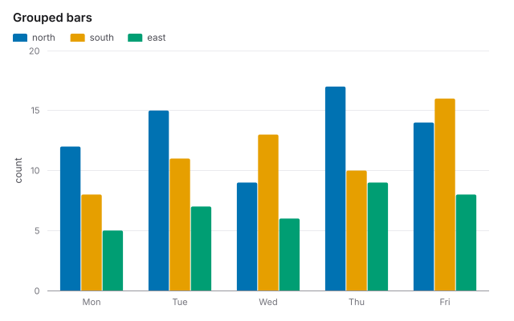 |  |
| **Stacked bars**, with a negative part (`stacked-bars`) |  | 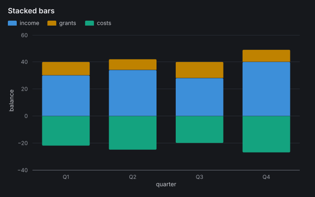 |
| **Histogram** — 2000 values (`histogram`) | 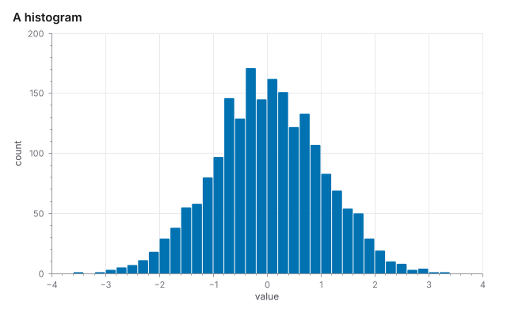 | 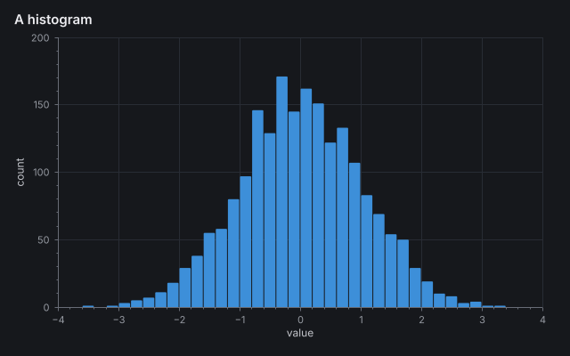 |
| **Error bars** and a fitted line (`error-bars`) | 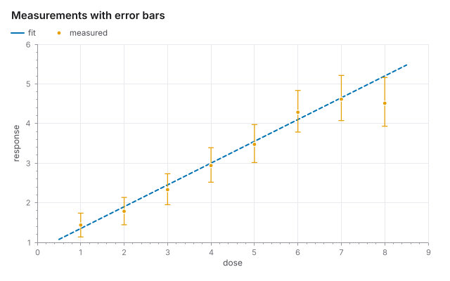 |  |
| **Logarithmic axis** — `n³`, `2ⁿ`, `n!` (`log-axis`) |  |  |
| **Small multiples** — four panels sharing both axes (`small-multiples`) | 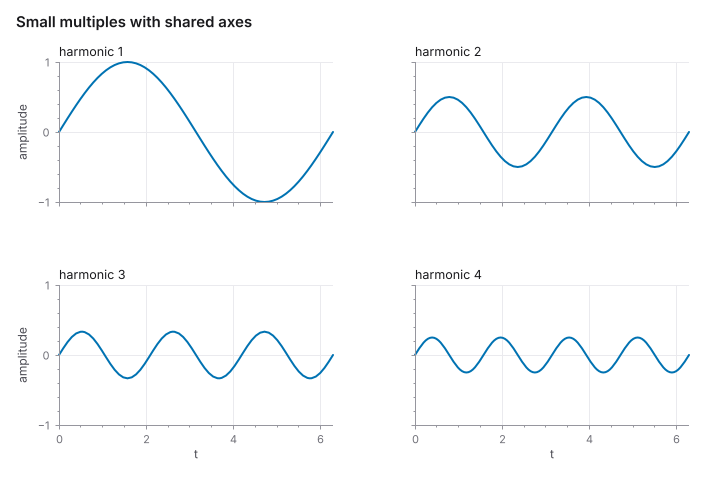 |  |
| **Awkward data** — no data, a constant, huge values, NaN and ∞ (`awkward-data`) | 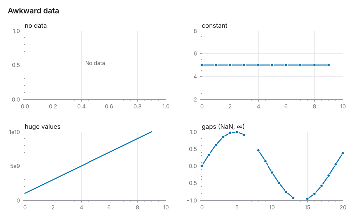 |  |

The PNG of each figure has the same name with `.png`.

## Plane figures

Figures of plane geometry (`PILeanTest/Examples.lean`, `PlaneFigures`, and
`PILeanTest/PlaneExact.lean`), in world coordinates fitted into the page with one scale, drawn on
the vector canvas; colours by role from `Style.plane`, light and dark (`-dark`).

| Figure | Light | Dark |
|---|---|---|
| **Two disks and a chord** — closed disks of radius `√(3 + φ)` about `±1`, the chord from `−E` to `E` (`E = ζ − ζ²`), `E` on the left circle and in its colour, `−E` on the right one and in its, the circles' crossings `±(ζ − ζ⁴)` as rings, a mark for a turn of 72° clockwise; every point exact in ℤ[ζ₅], and `disks_spec` says which item is which and proves each recorded incidence in ℚ(√5) (`plane-disks`) | 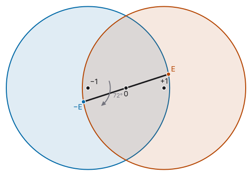 | 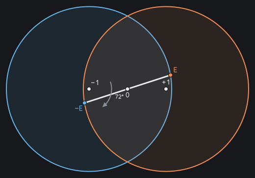 |
| **The elements** — a line and a ray clipped to the frame, a dashed circle, an arc with an arrowhead, a sector, a regular pentagon, a tinted triangle, a polyline, arrows, angle marks both ways, labels on four sides of a point (`plane-constructions`) | 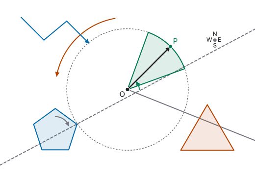 | 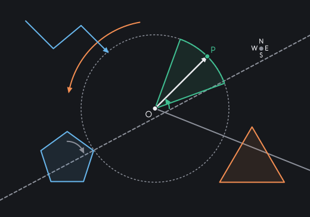 |
| **Exact points of ℤ[ζ₅]** — the unit steps `ζʲ` and a window disk; the steps in the window are decided exactly in ℚ(√5), and `zetaSteps_spec` says where each point is drawn (`plane-exact`) | 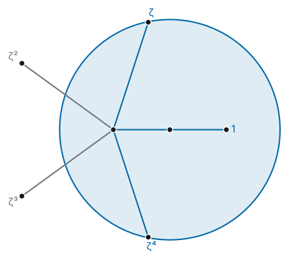 | 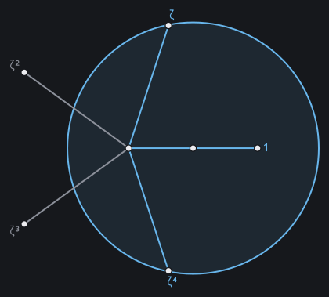 |

## Graphs

Graphs are Lean values (`PILeanTest/Examples.lean`, `GraphFigures`), laid out by
`PILean.Graph` and drawn on the vector canvas, so the SVG and the PNG (through the rasteriser,
text as shapes) show the same picture. Each is written light and dark (`-dark`).

| Graph | SVG | PNG |
|---|---|---|
| **Modules of a small compiler** — a layered layout with two clusters and a labelled edge (`compiler`) |  |  |
| **A module graph of 120 nodes** — layers, long edges as straight runs of dummy nodes (`modules`) | 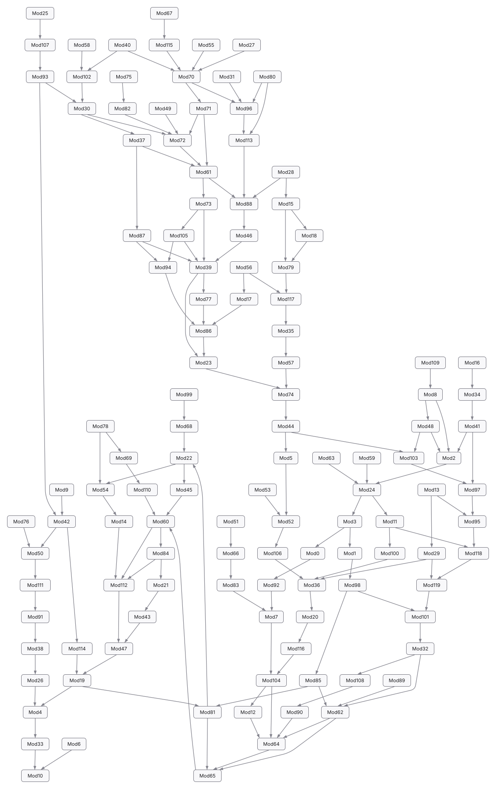 | 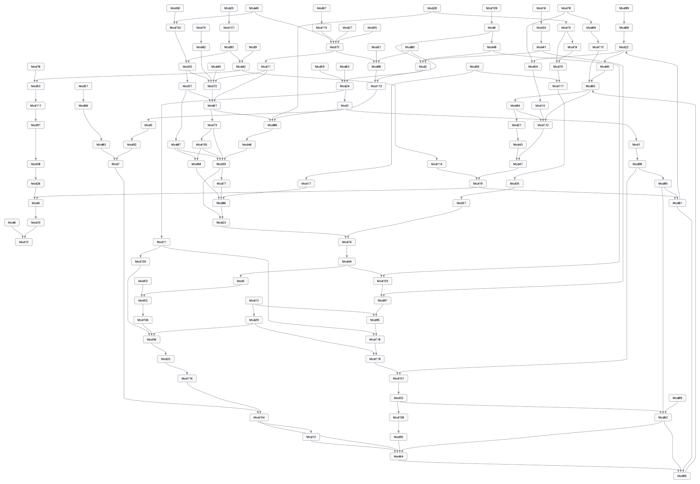 |
| **A ring of seven nodes** — the circular layout of an undirected graph (`ring`) |  |  |
| **A tree** — the tree layout (`tree`) | 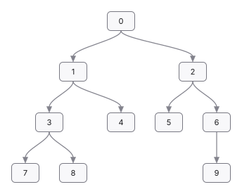 |  |

`graph-build`, among the animations below, is the compiler graph appearing layer by layer.

## Animations

Each animation is written four ways from one `Animation` value: an animated SVG (declarative SMIL
animation, no script), an animated PNG, a GIF, and a still poster frame, which the animated SVG
also shows instead of the motion when the viewer asks for reduced motion.

| Animation | SVG | APNG | GIF | Poster |
|---|---|---|---|---|
| **A travelling wave** — the path's points interpolated by the viewer between 30 keyframes (`wave`) |  |  |  | 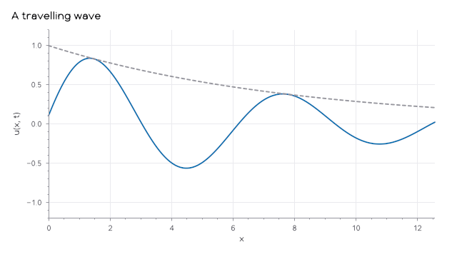 |
| **Growing bars**, played once (`growing-bars`) |  |  | 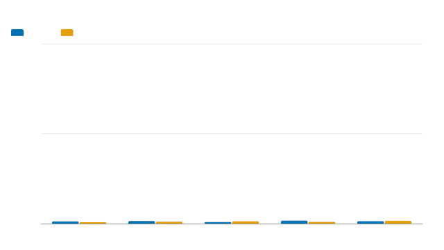 |  |
| **A graph building up**, layer by layer: every element in every frame, only opacities change, so the SVG interpolates (`graph-build`) |  |  |  | 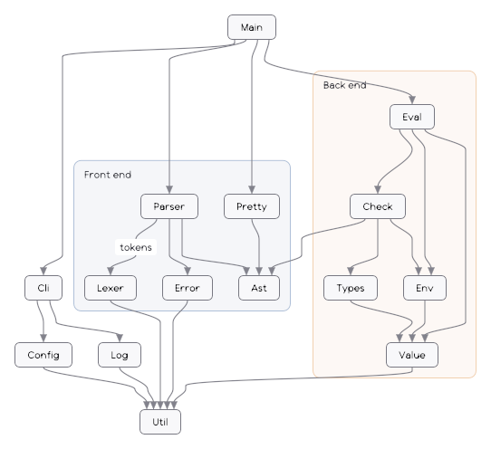 |

## Raster pictures

Drawn directly with `PILean.Raster.Draw` (`PILeanTest/Examples.lean`, `rasters`), written as PNG.

| Picture | PNG |
|---|---|
| **Cards with drop shadows** — `Path.roundedRect` filled over `Draw.dropShadow` (a Gaussian blur of its coverage), one card with a diagonal gradient, mixed in sRGB (`shadow-cards`) |  |

## Pictures with a theorem

One picture of each kind whose content is specified by a theorem about the Lean object it was
drawn from (see [`docs/PROOFS.md`](../docs/PROOFS.md): what is proved, what is tested, what is
trusted). The definitions and theorems are in
[`PILeanTest/ProvedExamples.lean`](../PILeanTest/ProvedExamples.lean); each picture is tagged
`@[figure]`. Light style shown; the dark style has the suffix `-dark`.

| Picture | Theorem |
|---|---|
|  **Function plot** (`provedFunction`) | `provedFunction_spec`: the figure's series are the cubic's and the parabola's and no other; the points of each are the 25 exact samples `(x, f x)` (of the cubic `x³ − x`, of the parabola `x² − 1`) on the grid `−3/2 + k/8`, `k = 0, …, 24`, converted one by one (`Exact.toFloat` is where floating point begins); the grid starts at `−3/2` and ends at `3/2`; every sample is `(x, f x)` with `x` on the grid. Nothing is proved about the curve between two samples. |
| 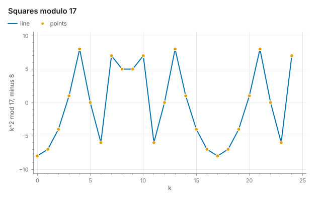 **Data plot** (`provedData`) | `provedData_spec`: the figure's series are a line and markers and no other; the line's and the markers' points are the list `residues` of 25 integer pairs, converted point for point, in order; the integers are recovered from the exact points, so none is added, dropped or changed. |
|  **Graph** (`provedGraph`) | `provedGraph_spec`: the nodes are the numbers 1 to 12, the edges are exactly the pairs `a < b` with `a ∣ b`, each once (an `example` beside the theorem counts 23), and the layout draws one route per edge, in order, with the edge's own index and ends (long edges pass through dummy nodes inside the layout and are still one route). |
|  **Animation** (`provedClock`) | `provedClock_spec`: frame `i` of the animation (in the SVG, the APNG and the GIF) is the drawing `clockFrame` at the time `i / 10`, the conversion of the exact rational number `i/10` to a floating-point number. The number of frames (10) is computed in floating point and is not part of the theorem. |

A fifth picture has a theorem over the real numbers. It belongs to the optional package
[`pilean-mathlib`](../mathlib/README.md), which requires Mathlib, and its files are in
[`mathlib/examples/`](../mathlib/examples/):

| Picture | Theorem |
|---|---|
|  **The sine** (`sineFigure`) | `sineFigure_spec`: the series' points are the 97 exact samples of the Taylor polynomial of the sine of degree 15 on the grid `−3 + k/16`, `k = 0, …, 96`, converted one by one; and the polyline through those exact samples is vertically within `δ = 1/2000` of the graph of the real sine over `[−3, 3]` (above every `x` of the interval, every point `(x, y)` of the polyline has `\|y − sin x\| ≤ 1/2000`). At this size, 640 × 400, one unit of the ordinate is 143.5 pixels, so `δ` is 0.072 pixel. The last step, from the exact numbers to the pixels, is floating point and tested, not proved. |

The PNG of each has the same name with `.png`; the animation's other files are
`proved-clock.png`, `proved-clock.gif` and `proved-clock-poster.png`.

## Checks against other software

```
lake exe pilean-test --compare-out /tmp/pilean-cmp && python3 -I tools/compare-render.py /tmp/pilean-cmp
lake exe pilean-test --anim-out /tmp/pilean-anim && python3 -I tools/anim-check.py /tmp/pilean-anim
```

The first renders each figure's SVG without its text with macOS's own SVG renderer (`sips`) and
compares it with PILean's PNG of the same nodes, pixel by pixel; the second decodes the animated
files with Python's standard library. The gallery's GIF and APNG files open in macOS's ImageIO
(`sips -g pixelWidth -g format FILE`).
