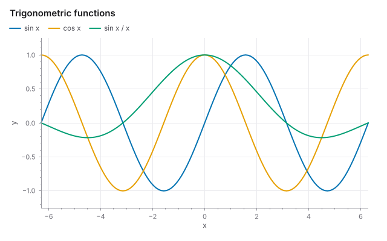
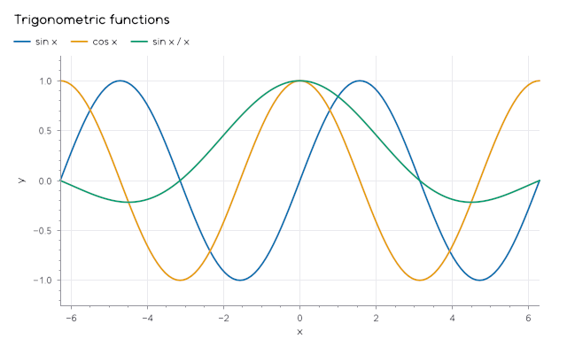
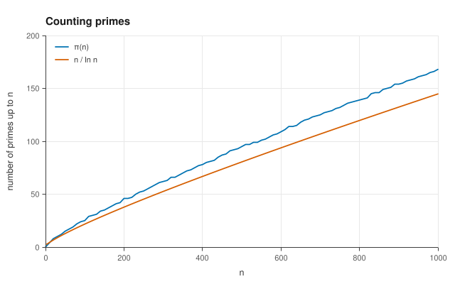
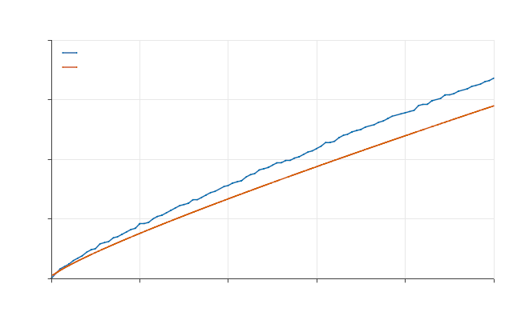
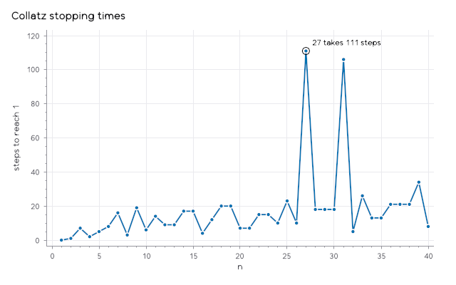
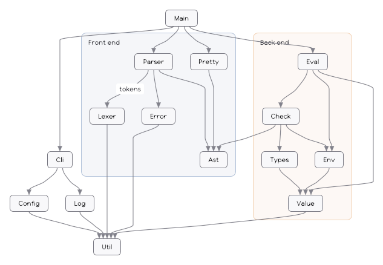
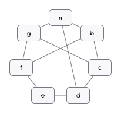
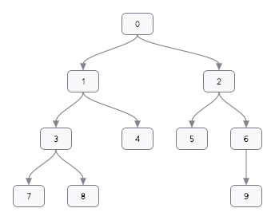

# Gallery

Each figure is a Lean value in [`PILeanTest/Examples.lean`](../PILeanTest/Examples.lean),
written twice by `lake exe pilean-gallery`: as SVG (`Figure.toSvg`) and as PNG through PILean's
own rasteriser and PNG encoder (`Figure.toPng`). Both are drawn from the same SVG nodes
(`Figure.render`), so they show the same picture. The PNGs have no text yet: PILean has no text
layer, so titles, axis labels and tick labels appear in the SVGs only. `lake test` checks that
both files are reproduced byte for byte.

| Figure | SVG | PNG |
|---|---|---|
| **Trigonometric functions** — `sin x`, `cos x` and `sin x / x` from −2π to 2π (`functions`) |  |  |
| **Counting primes** — the prime-counting function π(n) against n / ln n (`primes`) |  |  |
| **Collatz stopping times** — the steps from n to 1, with markers (`collatz`) |  |  |

## Graphs

Graphs are Lean values (`PILeanTest/Examples.lean`, `GraphFigures`), laid out by
`PILean.Graph` and drawn on the vector canvas, so the SVG and the PNG (through the rasteriser,
text as shapes) show the same picture. Each is written light and dark (`-dark`).

| Graph | SVG | PNG |
|---|---|---|
| **Modules of a small compiler** — a layered layout with two clusters and a labelled edge (`compiler`) |  |  |
| **A module graph of 120 nodes** — layers, long edges as straight runs of dummy nodes (`modules`) |  |  |
| **A ring of seven nodes** — the circular layout of an undirected graph (`ring`) |  |  |
| **A tree** — the tree layout (`tree`) |  |  |

`graph-build` is the compiler graph appearing layer by layer: an animated SVG (every element in
every frame, only opacities change, so the viewer interpolates), an animated PNG, a GIF and a
poster frame.


## The same picture twice

`tools/compare-render.py` renders each SVG without its text with macOS's own SVG renderer
(`sips`) and compares it with PILean's PNG of the same nodes, pixel by pixel. With colours mixed
in sRGB, as that renderer mixes them, the mean difference is 0.01 to 0.05 of a level (of 255) and
every figure has at least 99.99 % of its pixels within 32 levels (the tolerance: a mean below one
level and 99 % of pixels within 32 levels). PILean mixes in linear light by default, which makes
anti-aliased edges and overlaps differ from sRGB mixing by design (a mean of 0.2 to 0.5 levels).

```
lake exe pilean-test --compare-out /tmp/pilean-cmp
python3 -I tools/compare-render.py /tmp/pilean-cmp
```
