# Gallery

Every picture here is a Lean value in [`PILeanTest/Examples.lean`](../PILeanTest/Examples.lean),
written by `lake exe pilean-gallery`: figures as SVG (`Figure.toSvg`) and as PNG through PILean's
own rasteriser and PNG encoder (`Figure.toPng`), both drawn from the same canvas
(`Figure.draw`), in the light style and the dark one (`Style.dark`). `lake test` checks that every
file is reproduced byte for byte.

The SVG files carry their text as SVG text in the style's font family; the PNG files draw it with
PILean's built-in single-stroke lettering ([specimen](lettering-specimen.png)), so they look the
same everywhere.

## Plots

| Figure | Light | Dark |
|---|---|---|
| **Functions** — `sin x`, `cos x`, `sin x / x`, sampled adaptively (`function-plot`) |  |  |
| **Poles and jumps** — `tan x`, `1 / x`, `⌊x⌋ / 2`: broken at poles and jumps, no line across them (`poles`) | 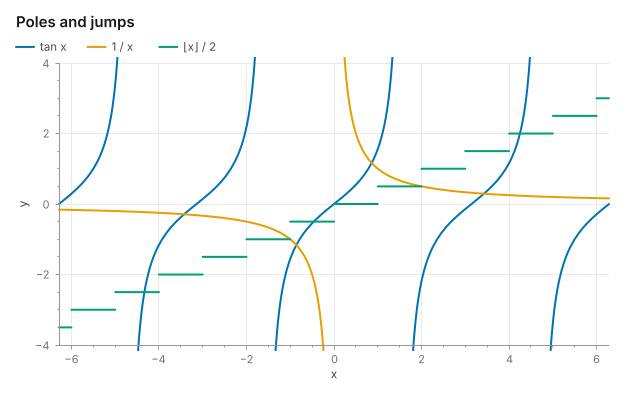 |  |
| **Step and dashed function** — π(n) as a step line against `n / ln n` (`primes-step-plot`) | 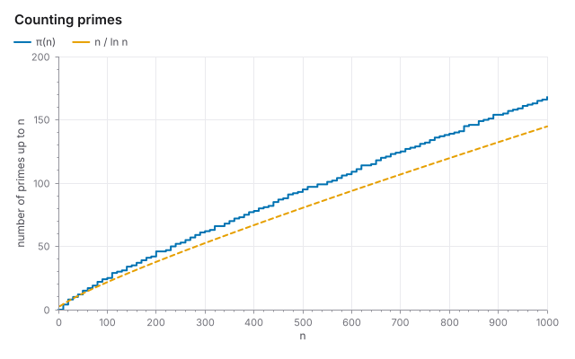 | 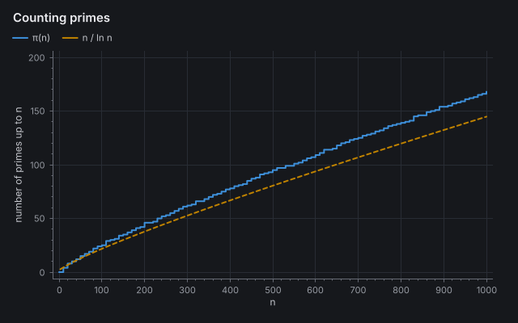 |
| **Line with markers and a labelled point** — Collatz stopping times (`collatz-data-plot`) |  |  |
| **Scatter** — two clusters (`scatter-plot`) | 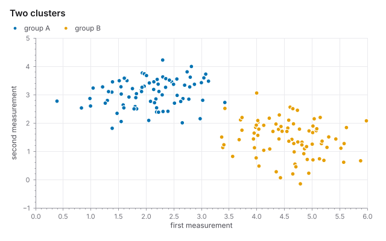 |  |
| **Band and area** — fill between two curves with its middle line, an area, a reference line (`band-area-plot`) | 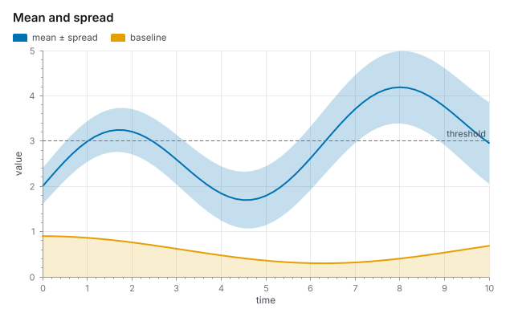 | 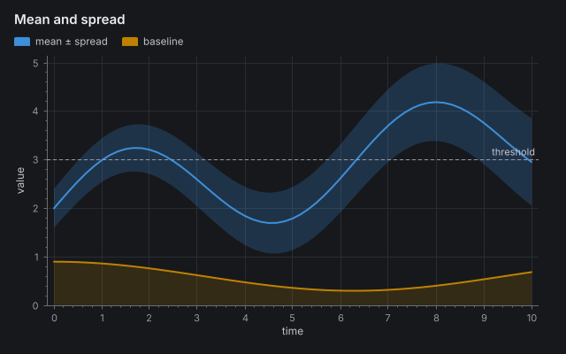 |
| **Grouped bars** (`grouped-bars`) |  | 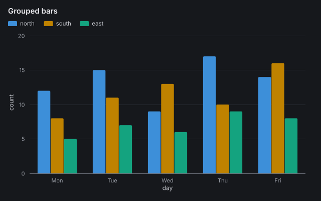 |
| **Stacked bars**, with a negative part (`stacked-bars`) |  |  |
| **Histogram** — 2000 values (`histogram`) |  |  |
| **Error bars** and a fitted line (`error-bars`) |  | 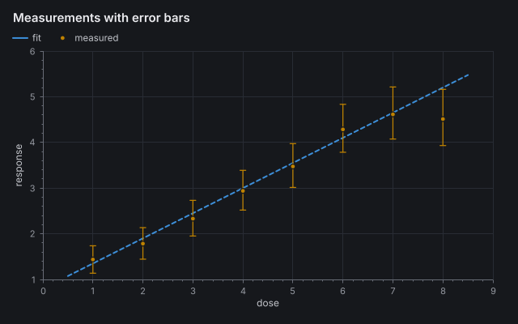 |
| **Logarithmic axis** — `n³`, `2ⁿ`, `n!` (`log-axis`) |  | 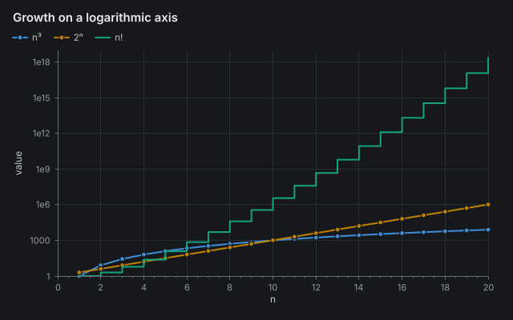 |
| **Small multiples** — four panels sharing both axes (`small-multiples`) |  | 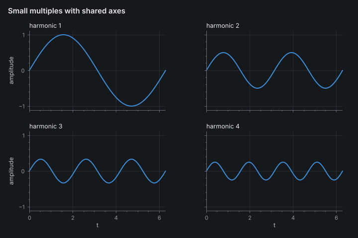 |
| **Awkward data** — no data, a constant, huge values, NaN and ∞ (`awkward-data`) |  |  |

The PNG of each figure has the same name with `.png`.

## Animations

Each animation is written four ways from one `Animation` value: an animated SVG (declarative SMIL
animation, no script), an animated PNG, a GIF, and a still poster frame, which the animated SVG
also shows instead of the motion when the viewer asks for reduced motion.

| Animation | SVG | APNG | GIF | Poster |
|---|---|---|---|---|
| **A travelling wave** — the path's points interpolated by the viewer between 30 keyframes (`wave`) |  |  |  |  |
| **Growing bars**, played once (`growing-bars`) | 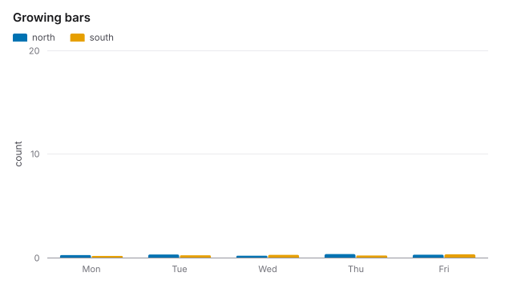 |  |  | 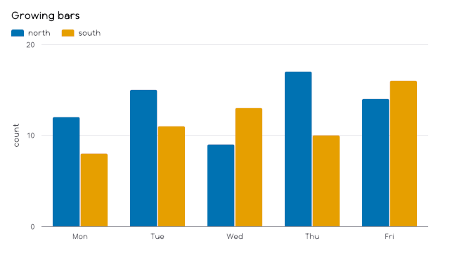 |

## Checks against other software

```
lake exe pilean-test --compare-out /tmp/pilean-cmp && python3 -I tools/compare-render.py /tmp/pilean-cmp
lake exe pilean-test --anim-out /tmp/pilean-anim && python3 -I tools/anim-check.py /tmp/pilean-anim
```

The first renders each figure's SVG without its text with macOS's own SVG renderer (`sips`) and
compares it with PILean's PNG of the same nodes, pixel by pixel; the second decodes the animated
files with Python's standard library. The gallery's GIF and APNG files open in macOS's ImageIO
(`sips -g pixelWidth -g format FILE`).
