# Gallery

Every picture here is a Lean value in [`PILeanTest/Examples.lean`](../PILeanTest/Examples.lean),
written by `lake exe pilean-gallery`: figures as SVG (`Figure.toSvg`) and as PNG through PILean's
own rasteriser and PNG encoder (`Figure.toPng`), both drawn from the same canvas
(`Figure.draw`), in the light style and the dark one (`Style.dark`). `lake test` checks that every
file is reproduced byte for byte.

The SVG files carry their text as SVG text in the style's font family; the PNG files draw it with
PILean's built-in single-stroke lettering ([specimen](lettering-specimen.png)), so they look the
same everywhere.

## Plots

| Figure | Light | Dark |
|---|---|---|
| **Functions** — `sin x`, `cos x`, `sin x / x`, sampled adaptively (`function-plot`) |  | 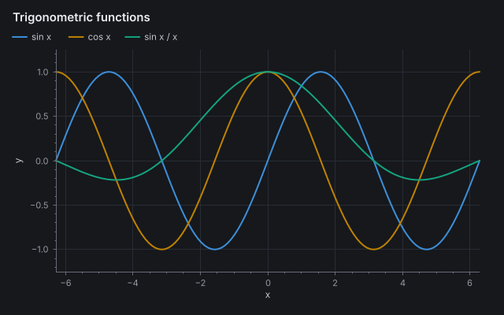 |
| **Poles and jumps** — `tan x`, `1 / x`, `⌊x⌋ / 2`: broken at poles and jumps, no line across them (`poles`) |  | 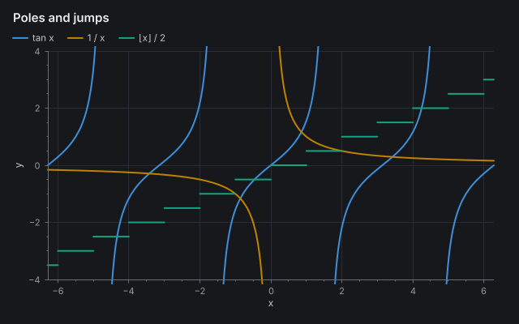 |
| **Step and dashed function** — π(n) as a step line against `n / ln n` (`primes-step-plot`) |  |  |
| **Line with markers and a labelled point** — Collatz stopping times (`collatz-data-plot`) |  | 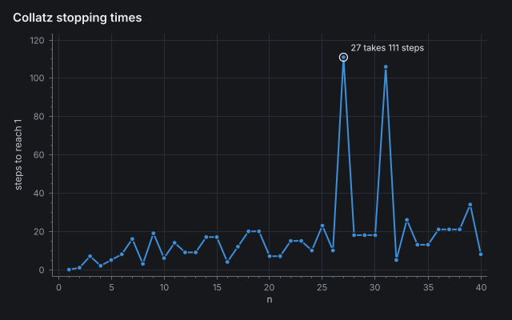 |
| **Scatter** — two clusters (`scatter-plot`) |  | 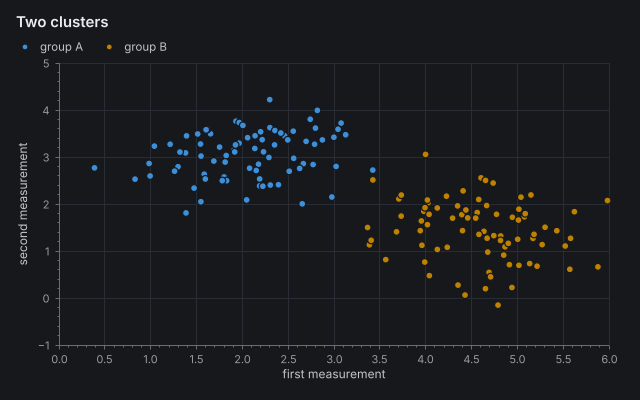 |
| **Band and area** — fill between two curves with its middle line, an area, a reference line (`band-area-plot`) |  |  |
| **Grouped bars** (`grouped-bars`) |  |  |
| **Stacked bars**, with a negative part (`stacked-bars`) | 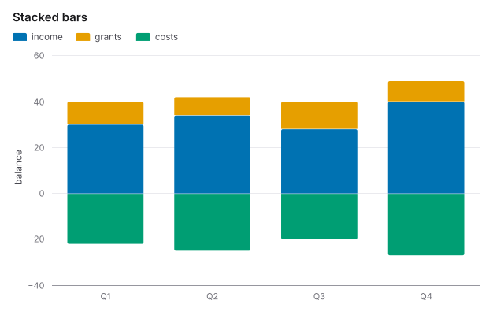 |  |
| **Histogram** — 2000 values (`histogram`) |  |  |
| **Error bars** and a fitted line (`error-bars`) |  |  |
| **Logarithmic axis** — `n³`, `2ⁿ`, `n!` (`log-axis`) | 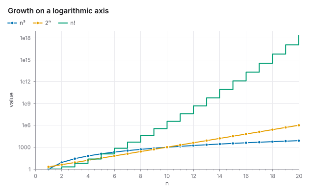 |  |
| **Small multiples** — four panels sharing both axes (`small-multiples`) |  |  |
| **Awkward data** — no data, a constant, huge values, NaN and ∞ (`awkward-data`) |  | 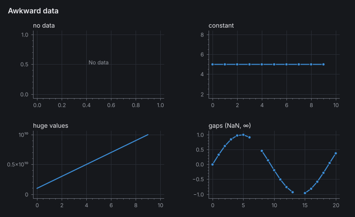 |

The PNG of each figure has the same name with `.png`.

## Graphs

Graphs are Lean values (`PILeanTest/Examples.lean`, `GraphFigures`), laid out by
`PILean.Graph` and drawn on the vector canvas, so the SVG and the PNG (through the rasteriser,
text as shapes) show the same picture. Each is written light and dark (`-dark`).

| Graph | SVG | PNG |
|---|---|---|
| **Modules of a small compiler** — a layered layout with two clusters and a labelled edge (`compiler`) | 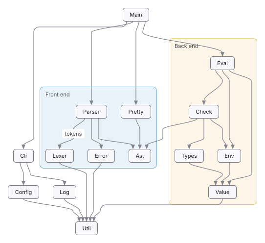 |  |
| **A module graph of 120 nodes** — layers, long edges as straight runs of dummy nodes (`modules`) |  |  |
| **A ring of seven nodes** — the circular layout of an undirected graph (`ring`) | 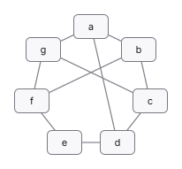 |  |
| **A tree** — the tree layout (`tree`) |  |  |

`graph-build`, among the animations below, is the compiler graph appearing layer by layer.

## Animations

Each animation is written four ways from one `Animation` value: an animated SVG (declarative SMIL
animation, no script), an animated PNG, a GIF, and a still poster frame, which the animated SVG
also shows instead of the motion when the viewer asks for reduced motion.

| Animation | SVG | APNG | GIF | Poster |
|---|---|---|---|---|
| **A travelling wave** — the path's points interpolated by the viewer between 30 keyframes (`wave`) |  | 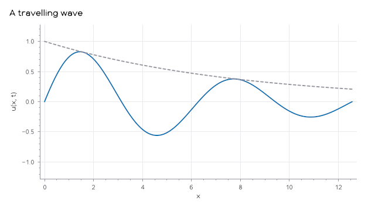 | 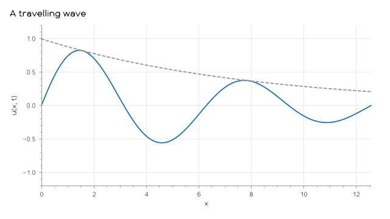 |  |
| **Growing bars**, played once (`growing-bars`) |  | 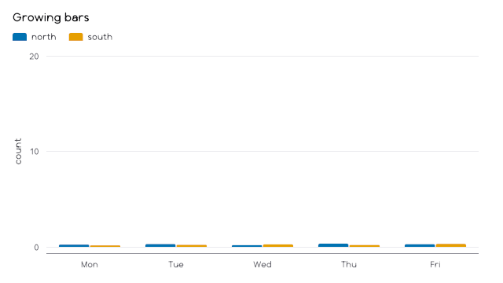 |  |  |
| **A graph building up**, layer by layer: every element in every frame, only opacities change, so the SVG interpolates (`graph-build`) |  | 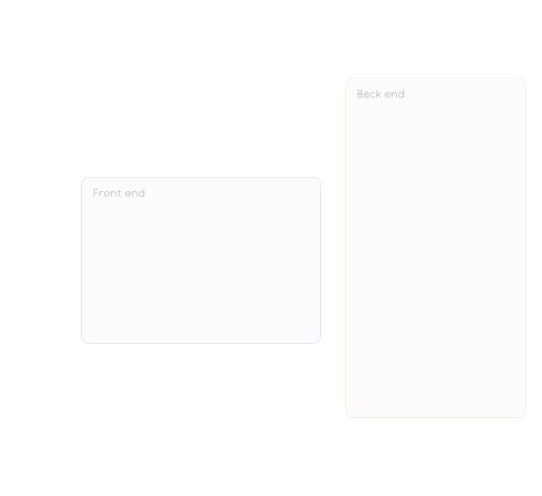 |  |  |

## Pictures with a theorem

One picture of each kind whose content is specified by a theorem about the Lean object it was
drawn from (see [`docs/PROOFS.md`](../docs/PROOFS.md): what is proved, what is tested, what is
trusted). The definitions and theorems are in
[`PILeanTest/ProvedExamples.lean`](../PILeanTest/ProvedExamples.lean); each picture is tagged
`@[figure]`. Light style shown; the dark style has the suffix `-dark`.

| Picture | Theorem |
|---|---|
| 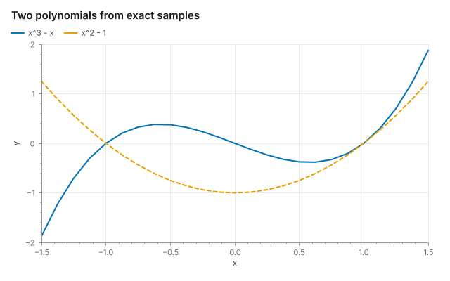 **Function plot** (`provedFunction`) | `provedFunction_spec`: the series' points are the 25 exact samples `(x, f x)` of the cubic `x³ − x` on the grid `−3/2 + k/8`, `k = 0, …, 24`, converted one by one (`Q.toFloat` is where floating point begins); the grid starts at `−3/2`, ends at `3/2` and has the constant step `1/8`; every sample is `(x, f x)` with `x` on the grid. |
|  **Data plot** (`provedData`) | `provedData_spec`: the line's and the markers' points are the list `residues` of 25 integer pairs, converted point for point, in order; the integers are recovered from the exact points, so none is added, dropped or changed. |
| 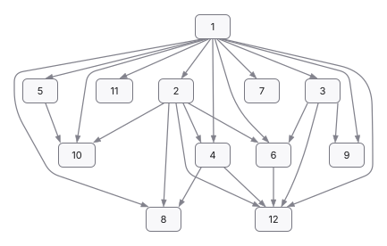 **Graph** (`provedGraph`) | `provedGraph_spec`: the nodes are the numbers 1 to 12, the edges are exactly the pairs `a < b` with `a ∣ b` (23 of them), each once, and the layout draws one route per edge, in order, with the edge's own index and ends (long edges pass through dummy nodes inside the layout and are still one route). |
| 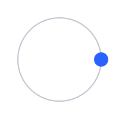 **Animation** (`provedClock`) | `provedClock_spec`: frame `i` of the animation (10 frames, in the SVG, the APNG and the GIF) is the drawing `clockFrame` at the time `i / 10`, the conversion of the exact fraction `i/10`. |

The PNG of each has the same name with `.png`; the animation's other files are
`proved-clock.png`, `proved-clock.gif` and `proved-clock-poster.png`.

## Checks against other software

```
lake exe pilean-test --compare-out /tmp/pilean-cmp && python3 -I tools/compare-render.py /tmp/pilean-cmp
lake exe pilean-test --anim-out /tmp/pilean-anim && python3 -I tools/anim-check.py /tmp/pilean-anim
```

The first renders each figure's SVG without its text with macOS's own SVG renderer (`sips`) and
compares it with PILean's PNG of the same nodes, pixel by pixel; the second decodes the animated
files with Python's standard library. The gallery's GIF and APNG files open in macOS's ImageIO
(`sips -g pixelWidth -g format FILE`).
