# PILean's plots against the real numbers

`pilean-mathlib` is an optional package beside PILean. It holds what PILean's core cannot say,
because the core has no real numbers: a specification, over ℝ, of what it means for a plotted
curve to be near the graph of a function, and theorems that connect PILean's exact computations
to that specification. It began with one specification, one general theorem and one figure, and now also ties
PILean's combinatorial diagrams to Mathlib's objects ("Combinatorial objects" below).

PILean itself has no dependencies, and nobody who uses PILean needs this package. It lives in
its own folder, requires [Mathlib](https://github.com/leanprover-community/mathlib4) (pinned in
`lakefile.lean`) and depends on PILean through the parent folder.

## What is proved

PILean plots an exact function `g : ℚ → ℚ` as the polyline through its exact samples
`(x, g x)`, `x` on the grid `lo + k (hi - lo) / n`, `k = 0, …, n` (`PILean.Exact.samples`, in the
core). The package reads those samples as points of the real plane.

**The specification** (`PILeanMathlib/Polyline.lean`).

* `PILean.polyline ps` is the union of the closed segments joining consecutive points of the
  list `ps`.
* `PILean.IsVerticallyWithin S f s δ` says that the set `S` of the plane is *vertically within
  `δ`* of the graph of `f` over `s`: every point of `S` has its abscissa in `s`; above every
  abscissa of `s` there is a point of `S`; and every point `(x, y)` of `S` has `|y - f x| ≤ δ`.

The distance is measured vertically, above each abscissa, because that is how a plot is read:
at `x`, how far is the curve from `f x`? It is the stronger of the two usual notions.
`IsVerticallyWithin.hausdorffDist_le` proves that a set vertically within `δ` of a graph is
within Hausdorff distance `δ` of it as a subset of the plane (for the maximum metric). The
converse is false: where a graph is steep, the same graph moved sideways a little stays close to
it as a set and is far from it above each abscissa.

**The general theorem** (`PILeanMathlib/Interpolation.lean`, `PILeanMathlib/ExactPlot.lean`).

* `PILean.abs_chord_sub_le`: if `f` is continuous on `[u, v]` and twice differentiable on the
  open interval `(u, v)` with `|f''| ≤ M` there, the chord through `(u, f u)` and `(v, f v)` is
  within `M (v - u)² / 8` of `f` on `[u, v]`. An example beside it shows that `1 / 8` cannot be
  improved.
* `PILean.Exact.isVerticallyWithin_plot`: let `g : ℚ → ℚ` be plotted with `n ≥ 1` steps on
  `[lo, hi]`, `lo < hi`, and let `f : ℝ → ℝ` be continuous on `[lo, hi]` and twice differentiable
  on `(lo, hi)` with `|f''| ≤ M` there. If `|g x - f x| ≤ ε` at every point `x` of the grid, then
  the polyline through the exact samples of `g` is vertically within `ε + M h² / 8` of the graph
  of `f` over `[lo, hi]`, where `h = (hi - lo) / n`.

The hypotheses on `f` are stated with named derivatives: functions `f'` and `f''` such that
`HasDerivAt f (f' x) x` and `HasDerivAt f' (f'' x) x` at every `x` of the open interval.
Nothing is assumed at the two ends beyond the continuity of `f`. `abs_chord_sub_le_of_deriv` and
`isVerticallyWithin_plot_of_deriv` are the same theorems with `deriv f` and `deriv (deriv f)`.

**The example** (`PILeanMathlib/Examples/SineFigure.lean`, `PILeanMathlib/Examples/Sine.lean`).

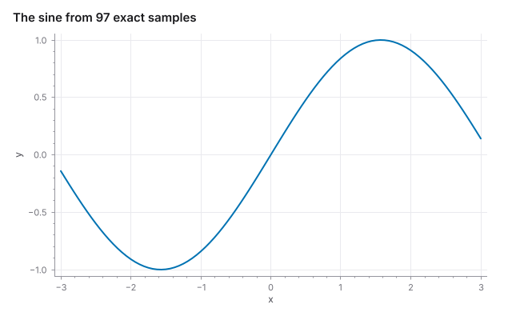

The figure `sineFigure` plots `sineTaylor`, the Taylor polynomial of the sine at 0 of degree 15
(an exact function on the rationals), on the grid of 96 steps from −3 to 3. The theorem
`sineFigure_spec` says:

* the figure has one panel, whose only series is `sineSeries`;
* the points of that series are the 97 exact samples of `sineTaylor` on that grid,
  converted one by one to floating point (the core's theorem about exact function plots);
* the polyline through those exact samples is vertically within **δ = 1/2000** of the graph of
  the real sine over `[−3, 3]`.

The bound is `3¹⁷ / 17! + (1/16)² / 8`, rounded up: about `3.6 · 10⁻⁷` for the polynomial at the
grid points (`PILeanMathlib.abs_sin_sub_taylor_le`, from Mathlib's Taylor theorem with the Lagrange
remainder) and `1/2048` for joining samples `1/16` apart by straight segments, the second
derivative of the sine being at most 1 in absolute value. At the gallery size, 640 × 400, one
unit of the ordinate is 143.5 pixels, so δ is 0.072 pixel.

The theorem is stated about the figure and the definitions it is built from (`sineFigure`,
`sineSeries`, `sineTaylor`, `lo`, `hi`, `steps`). Changing the polynomial, the interval, the
number of steps or the series the figure plots changes what must be proved, and the build fails
until it is. `figure_proves sineFigure sineFigure_spec` checks, when the package is built, that
the theorem is proved from the standard axioms and that its statement names the figure itself
(a statement about `sineSeries` alone is refused); it does not judge what the statement says.

## What is not proved

* **From the exact numbers to the pixels.** The theorem is about the exact samples, which are
  rational numbers, and the polyline through them in the real plane. PILean then converts each
  sample to a floating-point number, maps it to the page and rasterises the line; that last step
  is floating point and tested, not proved. So the statement is not "the pixels are within 0.072
  pixel of the sine"; it is "the exact polyline is within 1/2000 of the sine, and the picture is
  drawn from the exact polyline by tested floating-point code".
* The curve drawn is a line of a certain width; nothing is said about its width or its ends.
* Only the sine has an example. The general theorem needs, for each function, a rational
  approximation with a proved error at the grid points and a bound on the second derivative.

## Axioms

Every theorem depends on `propext`, `Classical.choice` and `Quot.sound` only.
`PILeanMathlib/Axioms.lean` checks every declaration of the package's modules (theorems and
definitions alike, without a list of names) and fails the build if one depends on another axiom,
or if the package declares an `axiom`, used or not; the build and `lake test` both fail if a file
of the package is left out of the check.
There is no `sorry`, no `native_decide`, and no definition the compiler replaces under a
theorem's subject.

## Building

The package needs Mathlib at the commit named in `lakefile.lean` and `lake-manifest.json`, on the
Lean version of `lean-toolchain`. A built Mathlib takes several gigabytes of disk; if you do not
have one, Lake downloads Mathlib's sources and `lake exe cache get` downloads its compiled files.

```
cd mathlib
lake exe cache get   # only if Mathlib's compiled files are not already in .lake/packages
lake build           # the library, with every theorem
lake test            # the checks below
lake exe pilean-mathlib-gallery   # writes examples/
```

With a built Mathlib already in `.lake/packages`, only the package's own modules are compiled. The
gallery and test programs import only the
module that defines the figure, so they contain no Mathlib code.

`lake test` builds the library and then checks what the theorems do not cover: the files of
`examples/` byte for byte, that the floating-point points of the figure lie where the exact ones
do (`-3 + k/16`, within `10⁻⁶` of the platform's sine, midpoints of segments within `1/2000`),
that every point has a position on the page, the number of pixels per unit used above, and that
the lakefile and the manifest name the same Mathlib commit.

## Use

In a project's `lakefile.lean`:

```lean
require «pilean-mathlib» from git "https://github.com/eric-vergo/PILean" @ "<commit>" / "mathlib"
```

Then `import PILeanMathlib` and apply `PILean.Exact.isVerticallyWithin_plot` to your exact
function, your real function, its two derivatives and the two bounds;
`PILeanMathlib/Examples/Sine.lean` is a complete example, and
`PILeanMathlib/ExactPlot.lean` ends with a smaller one (`x ↦ x²` on `[0, 1]`).

## Next steps

Not in this package:

* interval arithmetic, to obtain the approximation `g` and its error bound mechanically instead
  of by a hand-chosen Taylor polynomial (existing Lean libraries for it track other Mathlib
  versions or use `native_decide` in places);
* the exponential, the logarithm, square roots and other functions;
* exact geometry: carrying the bound through the axis scales and the rasteriser, so that a
  statement can be made about pixels;
* grids that are not uniform, and bounds from a Lipschitz derivative instead of a second
  derivative.

## Combinatorial objects

`PILeanMathlib/Combinatorics.lean` gives, for each kind of `PILean.Diagram` whose object Mathlib
has, a function from the Mathlib object to the kind's data and a theorem, stated with Mathlib's
definitions, that what the diagram draws is that object: a `SimpleGraph (Fin n)`'s drawn pairs are
its edges, a `Digraph`'s its arcs, an enumerated `PartialOrder`'s drawn edges its covers
(`CovBy`), a `YoungDiagram`'s drawn cells its cells, a `SemistandardYoungTableau`'s written entries
its entries, an `Equiv.Perm (Fin n)`'s cycle arrows `a → σ a` and wiring crossings its inversions,
a `DyckWord`'s rising steps its `U`s, and a `Finset`'s members are written inside its circle of a
Venn diagram ([`docs/PROOFS.md`](../docs/PROOFS.md), "Combinatorics against Mathlib").

The figures (`PILeanMathlib/Examples/CombinatoricsFigures.lean`, which imports nothing from
Mathlib) and their theorems (`PILeanMathlib/Examples/Combinatorics.lean`, linked by
`figure_proves`):

| Figure | Theorem | Light | Dark |
|---|---|---|---|
| The divisors of 60 | the elements are `Nat.divisors 60`; an edge joins `a` to `b` iff `a ∣ b` and `b / a` is prime | 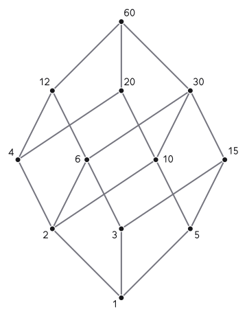 | 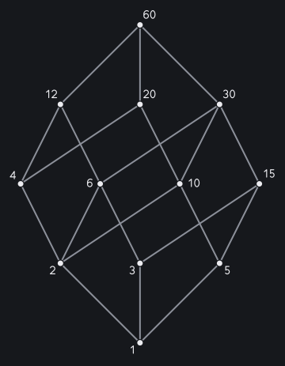 |
| The subsets of `{0, 1, 2}` | an edge joins `a` to `b` iff `subset a ⋖ subset b` in `Finset (Fin 3)` | 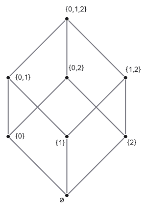 | 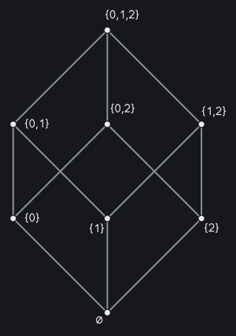 |
| The Petersen graph | the edges are those of a `SimpleGraph (Fin 10)`, disjointness of the 2-subsets of `Fin 5` | 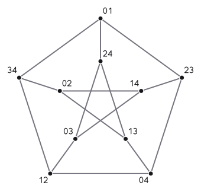 | 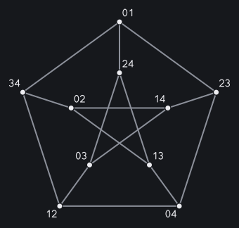 |
| The Young diagram of (5, 3, 3, 1) | the cells are those of `YoungDiagram.ofRowLens [5, 3, 3, 1]` | 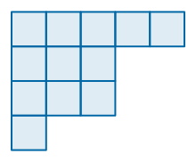 |  |
| The highest-weight tableau of (4, 3, 1) | the entries are those of `SemistandardYoungTableau.highestWeight` | 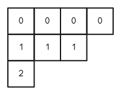 | 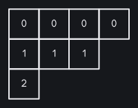 |
| The cycles of `(0 3)(2 4)` | an arrow `a → b` iff `σ a = b` | 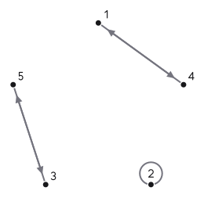 | 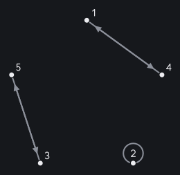 |
| Its wiring diagram | the crossings are its six inversions, and its sign is `(-1)` to their number | 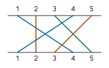 | 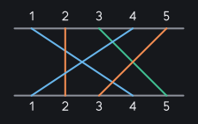 |
| The Dyck word `UUDUUDDDUD` | the steps are the path of the `DyckWord`, rising exactly at its `U`s | 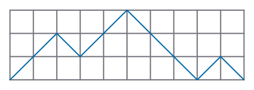 | 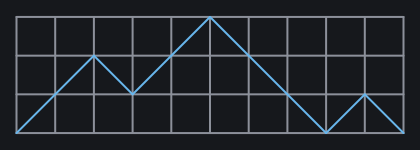 |
| Multiples of 2, 3, 5 up to 12 | each number is inside the circle of each `Finset` iff it belongs to it | 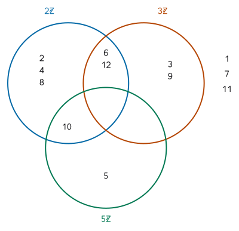 | 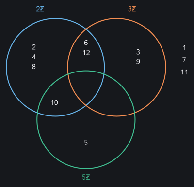 |

## Algebra and categories

`PILeanMathlib/Category.lean` realises a commutative diagram of PILean in a category: an object
for each object and a morphism for each arrow, between the objects of its ends
(`CommDiagram.Realisation`). Its `Commutes` says that the two paths of every claim compose to the
same morphism, and its `StylesHold` that every mark of an arrow's style is true of its morphism:
`↣` and `↪` are `Mono`, `↠` is `Epi`, `≅` is `IsIso`, `=` is an identity. For three shapes the
condition is Mathlib's own: the square of `f`, `g`, `h`, `i` commutes exactly when
`CommSq f g h i` (`square_commutes_iff`), the triangle exactly when `f ≫ g = h`
(`triangle_commutes_iff`), and the drawing `0 → X₁ ↣ X₂ ↠ X₃ → 0` of a short complex has its
marks justified and the complex exact exactly when `S.ShortExact` (`shortExact_iff`).

`PILeanMathlib/Group.lean` gives the table of a group through an enumeration `e : Fin n ≃ G`
(`FinMagma.ofMul`): cell `(a, b)` holds `e a * e b`, the table is a group by the core's decidable
check, it is symmetric exactly when the group is commutative, its centre is `Subgroup.center G`,
and the arrows of a Cayley graph join `g` to `g * s`. `FinPoset.mem_coverPairs_of_equiv` draws any
finite partial order through an enumeration with its covers `⋖` as edges; a lattice of subgroups
is drawn that way.

| Figure | Theorem | Light | Dark |
|---|---|---|---|
| The Cayley table of `DihedralGroup 4` | cell `(a, b)` holds `a * b`; a group, not commutative; the elements whose row equals their column are `Subgroup.center`, `{1, r 2}` | 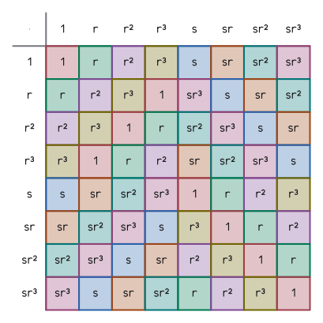 | 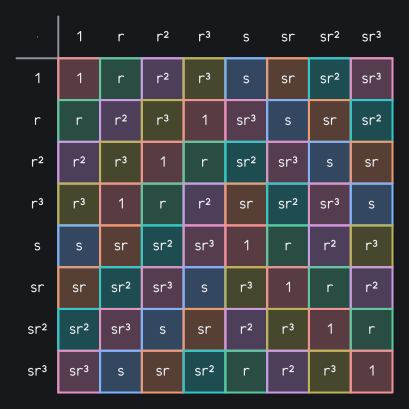 |
| Its Cayley graph for `r` and `s` | every arrow joins `g` to `g * r 1` or `g * sr 0`; twelve arrows | 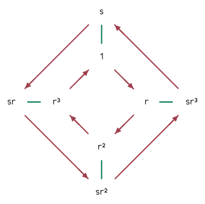 | 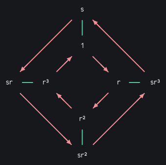 |
| Its subgroups | the drawn elements are all the subgroups of `DihedralGroup 4`, each once; edges are `⋖`; a dot is in colour iff its subgroup is `Normal` | 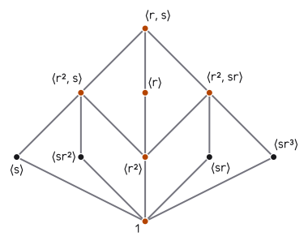 | 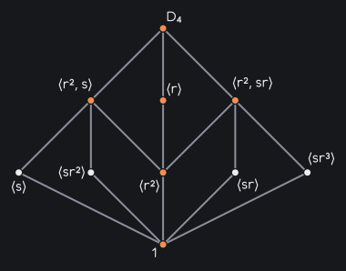 |
| A square of reductions in `Type` | the square is a `CommSq` of `ZMod 12 → ZMod 6 → ZMod 2` and `ZMod 12 → ZMod 4 → ZMod 2` | 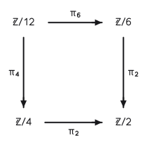 | 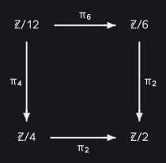 |
| `0 → A ↣ B ↠ C → 0` | for every short complex of a preadditive category with a zero object, the marks hold and it is exact iff it is `ShortExact` | 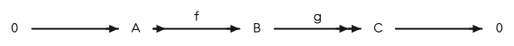 |  |

What these theorems do not cover is what no theorem of PILean covers: how the exact marks are
drawn (floating point, the frame, text, colours, the rasteriser).
